

  <h1>Neo</h1>
  <h3>by shadow</h3>
  <h3>total time spent : 49 hours </h3>

--- 

### journal #1 research and picking the chip 
time spent : 3.5 hours   

  
ok so this is the biggest project i have done so far. i wanted to make my own wireless keyboard, a 75% one because full size is too big and 60% has no arrow keys and no f row, and i use both all the time  
  
spent a lot of time just looking at what chip to use. i went with the nordic nrf52840 because:
- it has bluetooth 5 so the keyboard can be wireless
- it also has native usb, so the same chip works when you plug it in with a cable
- zmk (the keyboard firmware) supports it really well, a lot of wireless keyboards use it  

the scary part is the package. its an aQFN with 73 tiny pads in a 7x7mm square, some of them are even on the inside rows. i also read the nordic reference design like 3 times to understand the antenna and power stuff, because if the rf part is wrong the bluetooth just wont work
  

  
| the nrf52840 footprint, look at how tiny those pads are |
| --- |
| 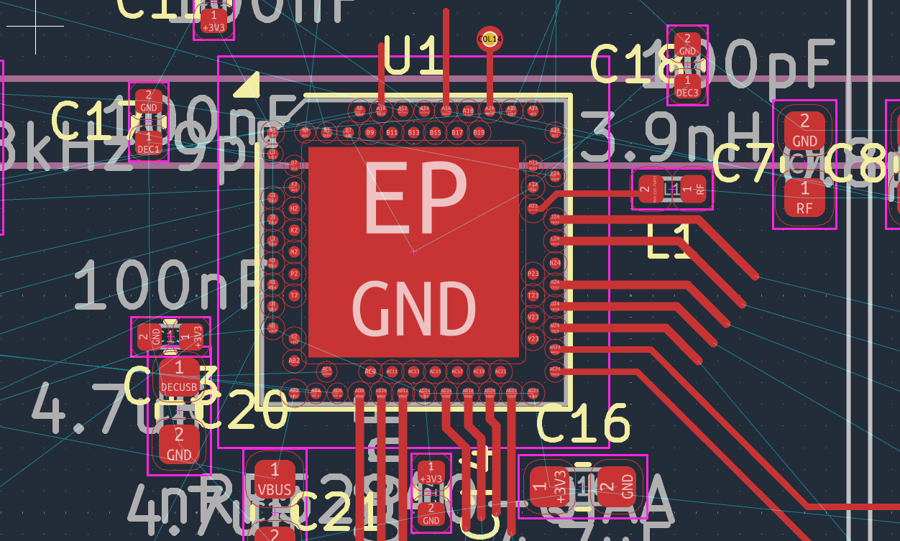 |

--- 

### journal #2 usb c input  
time spent : 1.5 hours   

  
started the schematic with the usb c port, i have done this a few times now so it went pretty quick. 5.1k pulldowns on CC1 and CC2 so c to c chargers actually give power, a 500mA fuse on vbus and a USBLC6 esd chip on the data lines. the usb c is used for both typing over a cable and charging the battery
  

  
| usb c schematic |
| --- |
| 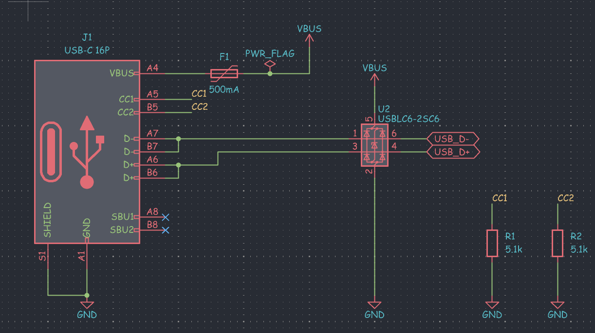 |

--- 

### journal #3 battery charger and power  
time spent : 2.5 hours   

  
since its wireless it needs a battery. i went with a single cell lipo on a jst ph connector and an MCP73831 to charge it. the charge current is set by one resistor, 10k gives 100mA which is safe for a small battery. also added a red led that turns on while it charges  
  
the power part took longer than i thought. i wanted the keyboard to run from usb when its plugged in and from the battery when its not, without them fighting each other. so i used an AO3401A p-mosfet and a B5819W diode for load sharing. when usb is plugged in the mosfet turns off and everything runs from usb while the battery charges, and when you unplug it the mosfet turns on and the battery takes over  
  
for 3.3v i used an XC6220 ldo, it only uses 8uA when idle which is really important for a bluetooth keyboard so the battery lasts long. added a power switch that turns off the regulator (the battery still charges when its off) and a resistor divider so the nrf can read the battery voltage and show the percentage
  

  
| lipo charger |
| --- |
| 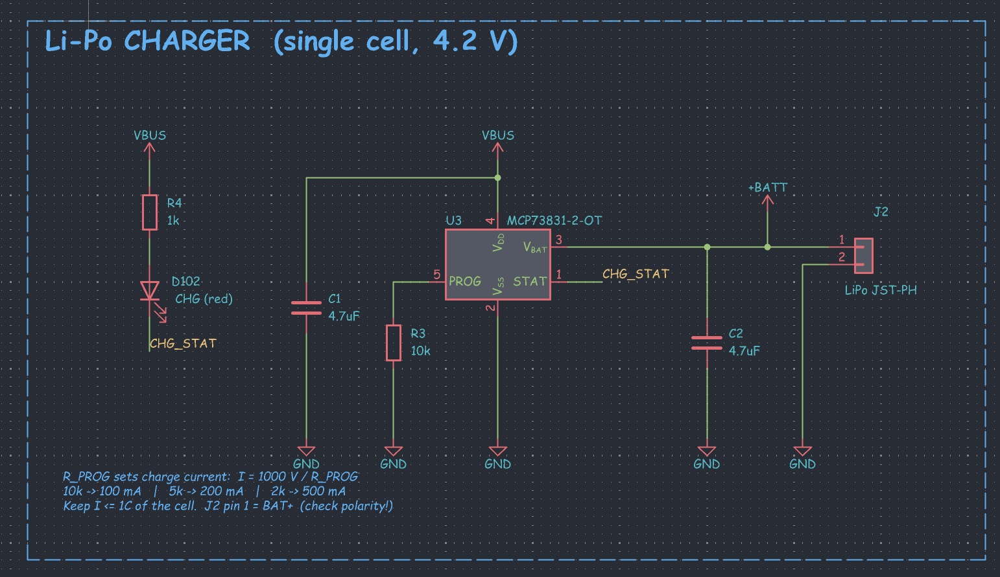 |

--- 

### journal #4 the nrf52840 schematic  
time spent : 4 hours   

  
this was the hardest schematic i have ever done ngl. the nrf52840 needs so much stuff around it:
- a 32MHz crystal for the main clock and a 32.768kHz one for low power mode, both with their load caps
- a 100nF cap on every vdd pin plus the bigger ones
- two inductors (10uH and 15nH) for the internal dc/dc converter, which cuts the current a lot when the radio is on
- a 2.4GHz chip antenna (2450AT18B100) with a small filter in front of it (3.9nH inductor + caps), and an extra cap pad that i can use to tune the antenna later  

i followed the nordic reference design for almost all of this because rf is not something i want to guess. also added a 2x5 swd header so i can flash the bootloader, and a blue led for bluetooth status. i wrote notes everywhere in the schematic about why things are the way they are, like the nfc pins being used as normal gpio, because i know i would forget
  

  
| how the mcu and rf part ended up on the board |
| --- |
| 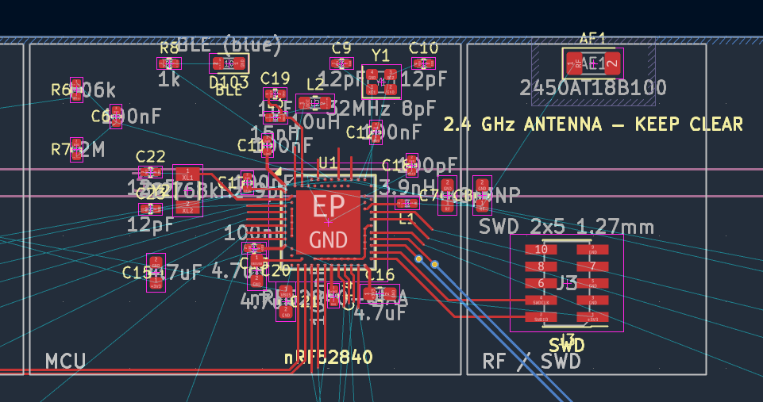 |

--- 

### journal #5 the key matrix  
time spent : 2 hours   

  
84 keys, so the matrix is 6 rows and 16 columns. every switch has its own 1N4148W diode so you can press multiple keys at the same time without ghosting. drawing 84 switches and 84 diodes by hand would take forever, so i drew one row properly and then copy pasted and relabelled. still took a while to get all the row and column labels right
  

  
| key matrix |
| --- |
| 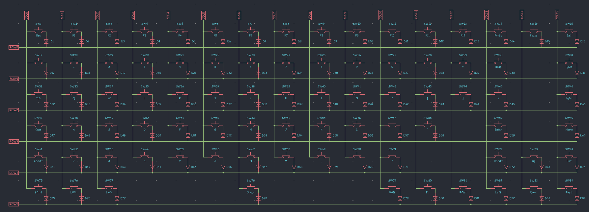 |

--- 

### journal #6 footprints and the big dump  
time spent : 1.5 hours   

  
assigned footprints to everything. kailh hotswap sockets for the switches so you can swap switches without soldering, sod-123 for the diodes, and 0402 for most of the small parts near the chip so they fit. then i updated the pcb from the schematic and... yeah
  

  
| everything dumped into the pcb editor |
| --- |
| 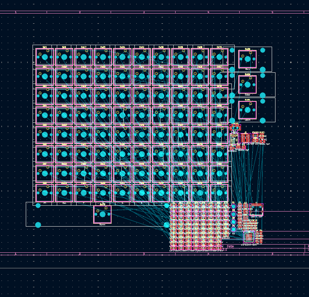 |

thats 85 switches, 87 diodes and a bunch of other parts all on top of each other lol. this is when i realised how much work the placing is gonna be

--- 

### journal #7 placing the switches  
time spent : 3 hours   

  
placed all the switches in the 75% ansi layout. every key has to be exactly 19.05mm apart, and the bigger keys like space, shift, enter and backspace need different spacing and the stabilizer holes. i used the grid a lot and measured everything twice. the board ended up 304.8 x 144.3 mm. then i put each diode right next to its switch  
  

  
| all the switches placed |
| --- |
| 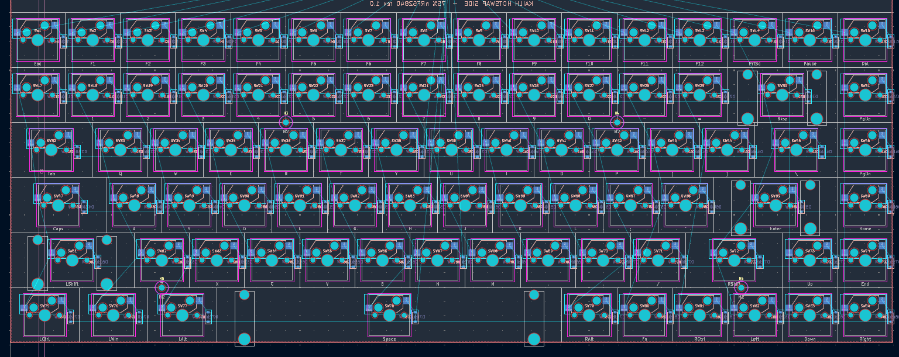 |

--- 

### journal #8 placing the nrf52840 and the antenna  
time spent : 2.5 hours   

  
put the mcu on the top edge of the board above the f row, because the antenna needs to be near the edge with nothing around it. all the decoupling caps went as close as possible to their pins, and the crystals right next to the chip  
  
the antenna needs a keepout area, no copper at all under it or around it on any layer, otherwise the bluetooth range gets really bad. i drew a keepout zone on all 4 layers and wrote "KEEP CLEAR" on the silkscreen so i dont accidentally route through it
  

  
| nrf52840 placement |
| --- |
| 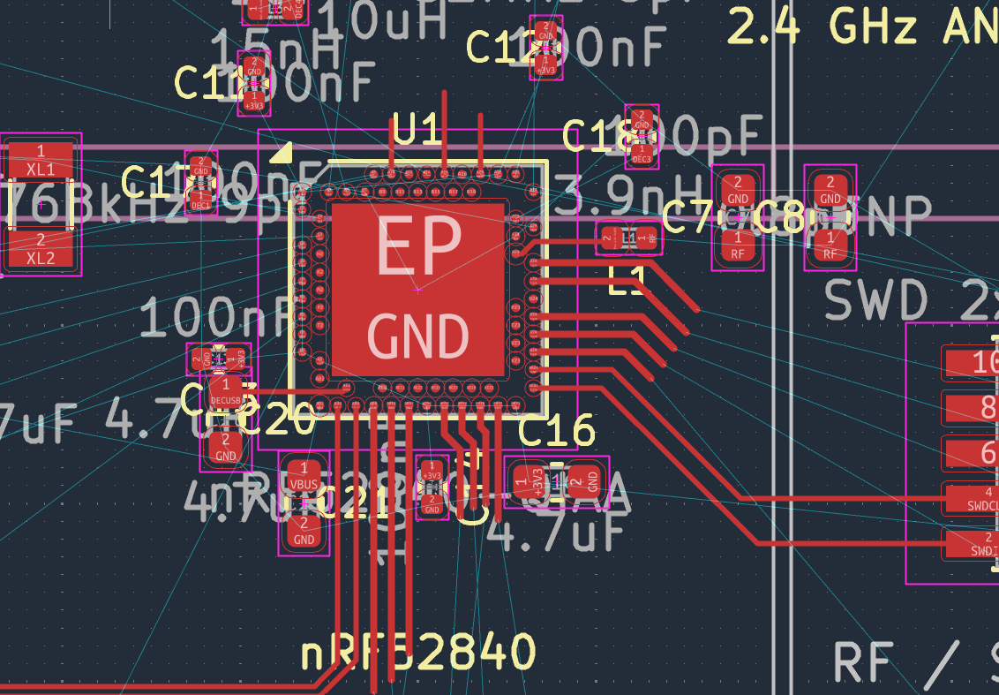 |

--- 

### journal #9 4 layers and the usb c  
time spent : 1.5 hours   

  
this is my first 4 layer board! the stackup i went with:
- top: signals + ground fill
- inner 1: a full solid ground plane
- inner 2: some power traces
- bottom: signals + ground fill  

having a solid ground plane right under the top layer helps a lot with the rf trace and the usb lines. i also made different net classes so the traces are the right width without thinking about it, 0.15mm for the tiny stuff around the chip, 0.2mm for the matrix, 0.4mm for power and 1.1mm for the rf trace to the antenna  
  
started routing with the usb c, the pads on these are so small
  

  
| usb c routing |
| --- |
| 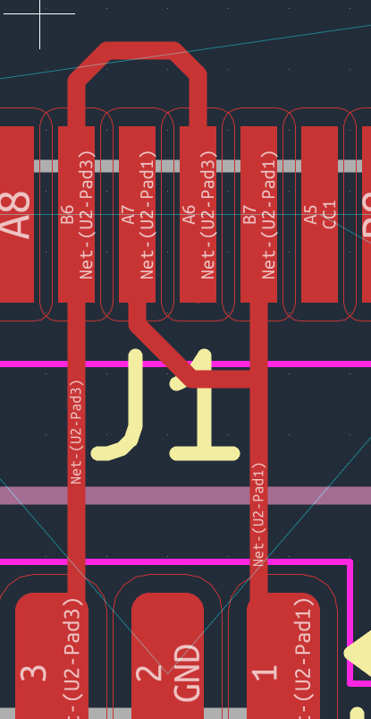 |

--- 

### journal #10 routing the nrf52840  
time spent : 4 hours   

  
the fanout from the nrf took forever. the pads are 0.5mm apart so i had to use the 0.15mm traces and smaller vias to get out of the chip, especially for the inner pads. first did the power and decoupling, then the crystals, then the rf trace which has to be short and straight to the antenna
  

  
| fanout from the chip |
| --- |
| 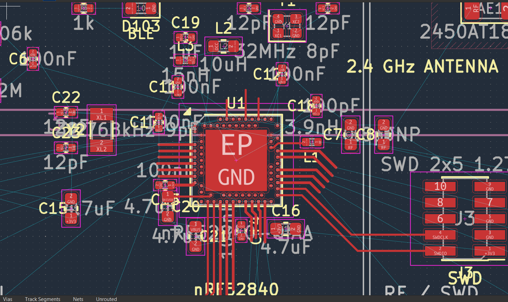 |

then all the gpio lines for the rows and columns, which i ran out the bottom of the chip and down the board on the back layer

  
| mcu routed |
| --- |
| 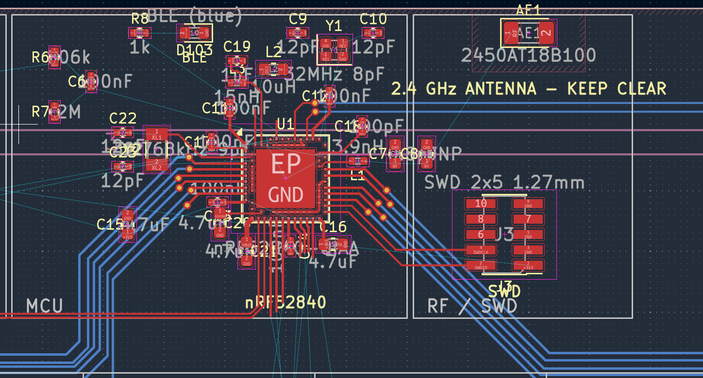 |

--- 

### journal #11 routing the matrix  
time spent : 4 hours   

  
22 lines going all across a 30cm board. i did the rows on one layer and the columns on the other so they can cross without vias everywhere, then connected each switch and diode. it was a lot of the same thing over and over, honestly kinda relaxing after the nrf part lol. had to be careful around the stabilizer holes and the bigger keys
  

  
| matrix routed |
| --- |
| 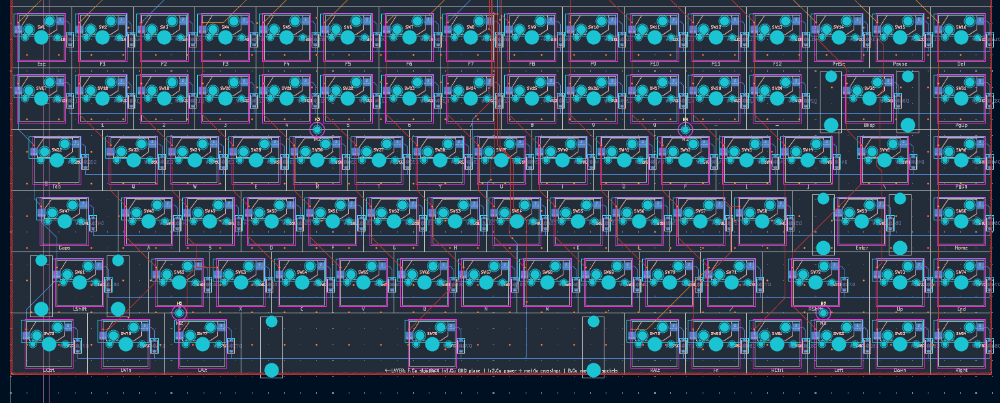 |

--- 

### journal #12 power section, swd and ground  
time spent : 2.5 hours   

  
routed the power part last, the charger, the mosfet, the diode, the regulator and the power switch, all with the thick 0.4mm traces. then the swd header and the leds  
  

  
| power section | swd header |
| --- | --- |
| 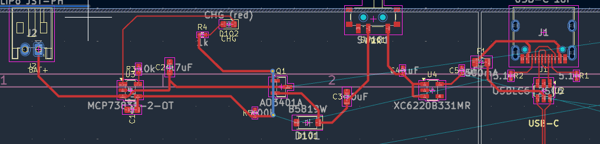 | 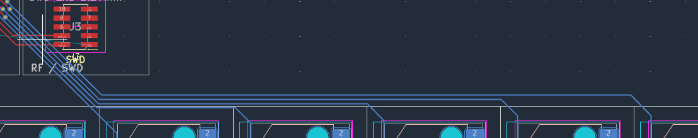 |

after that i added the ground fills on top and bottom and the ground plane on inner 1, and added a ton of vias to stitch all the grounds together. the board has 512 vias in total now which is crazy. also added 6 m2 mounting holes so it can screw into the case. ran drc and fixed everything it complained about

--- 

### journal #13 bringing the pcb into fusion  
time spent : 1 hour   

  
exported the board as a step file from kicad and imported it into fusion 360 so i can design the case around the real pcb. this way the holes and the usb c cutout will line up perfectly
  

  
| pcb in fusion |
| --- |
| 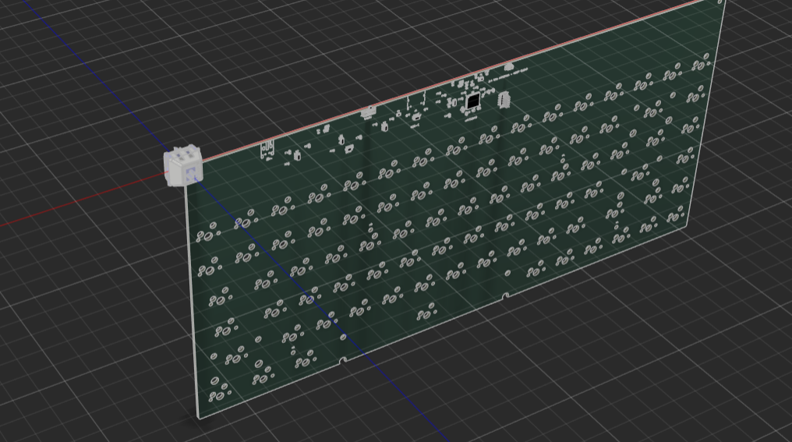 |
| 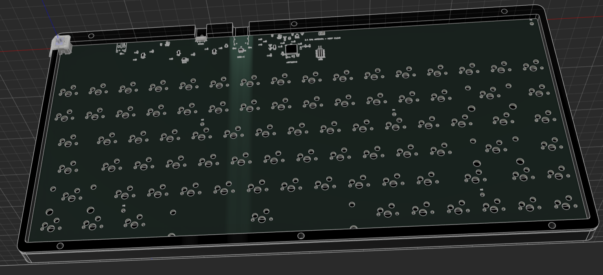 |

--- 

### journal #14 designing the case  
time spent : 3.5 hours   

  
made the bottom of the case first. its basically a tray that the pcb sits in, with rounded corners and enough space under the pcb for the battery. i gave it a tilt, so the back is higher than the front, which makes typing more comfortable. getting the angle right and making sure the pcb still sits flat inside took a few tries
  

  
| case bottom | the tilt |
| --- | --- |
| 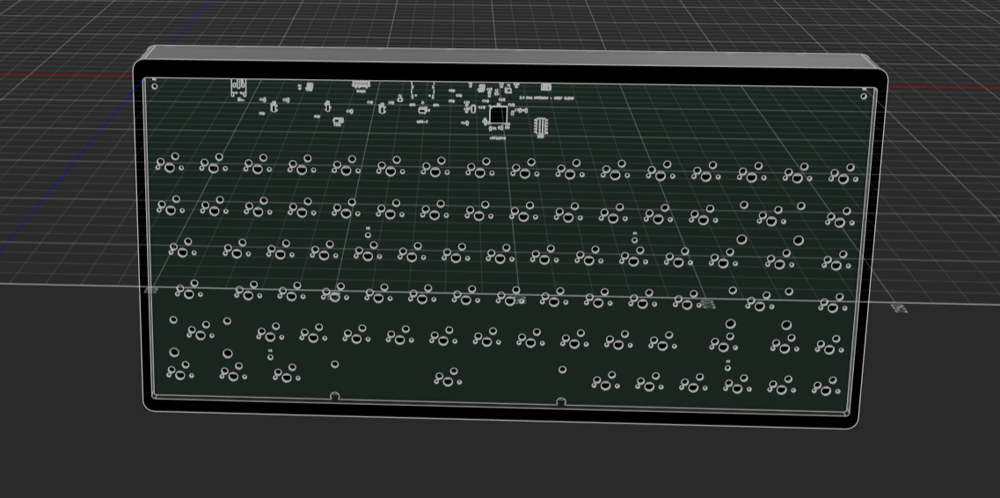 | 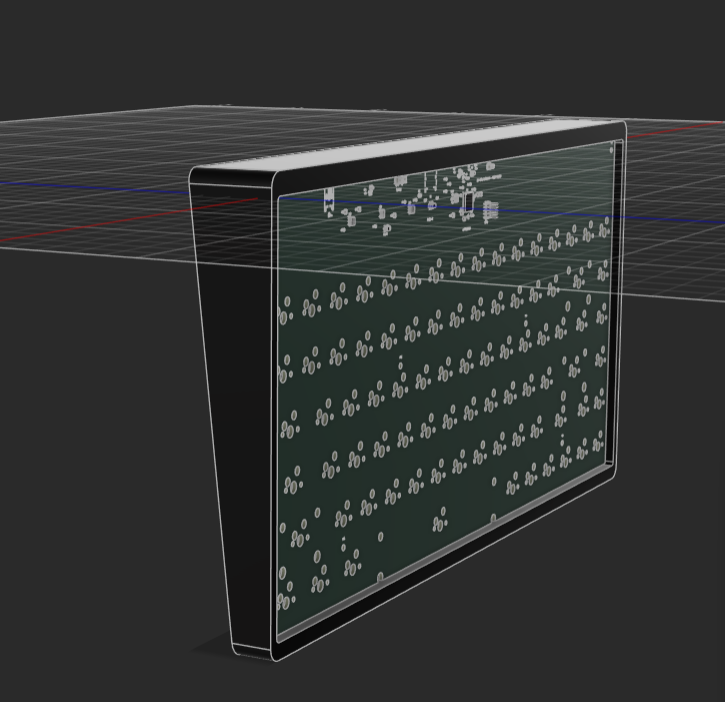 |

--- 

### journal #15 plate and top frame  
time spent : 3 hours   

  
then the switch plate, which holds the switches in place. every switch needs a 14mm square cutout in exactly the same spot as on the pcb, so i projected the switch positions from the pcb and cut them out. the stabilizers need their own cutouts too  
  

  
| switch plate |
| --- |
| 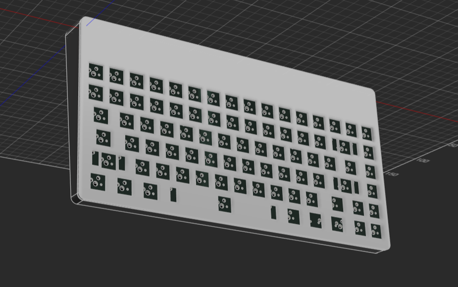 |

and the top frame that goes over it, i made it red because i think a red keyboard looks so cool. added some slanted vent lines in the top right corner just for the looks and a small hole for the leds

  
| top frame |
| --- |
| 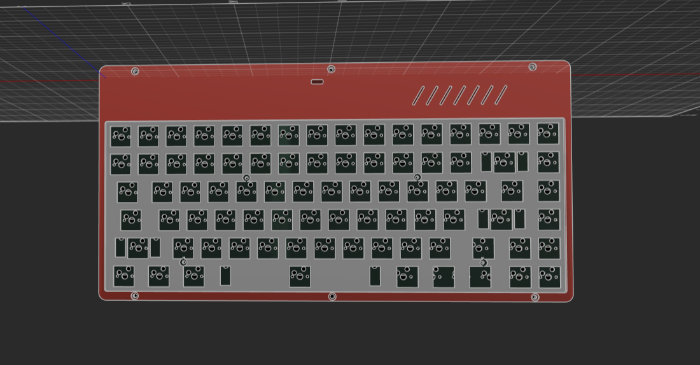 |
| 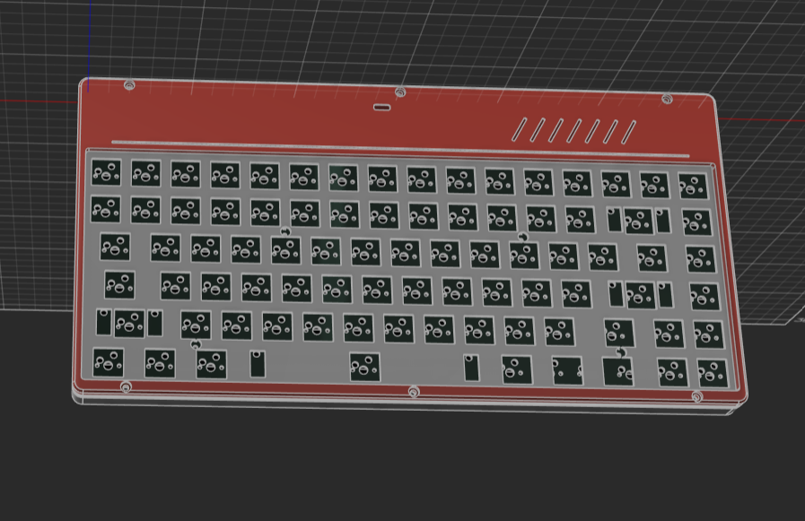 |

--- 

### journal #16 first renders  
time spent : 2 hours   

  
put everything together in fusion with keycaps on top and took some quick renders. honestly it looks so much better than i expected, it actually looks like a real keyboard :D
  

  
| final renders |
| --- |
| 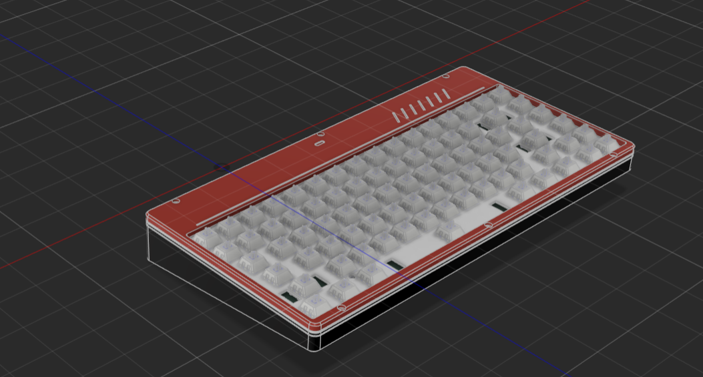 |
| 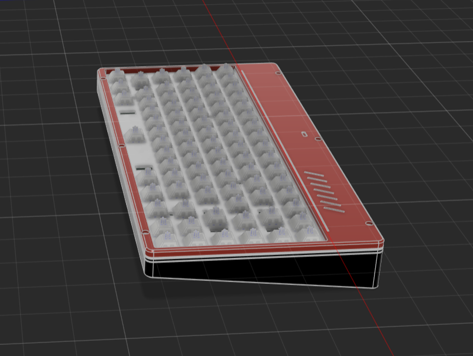 |
| 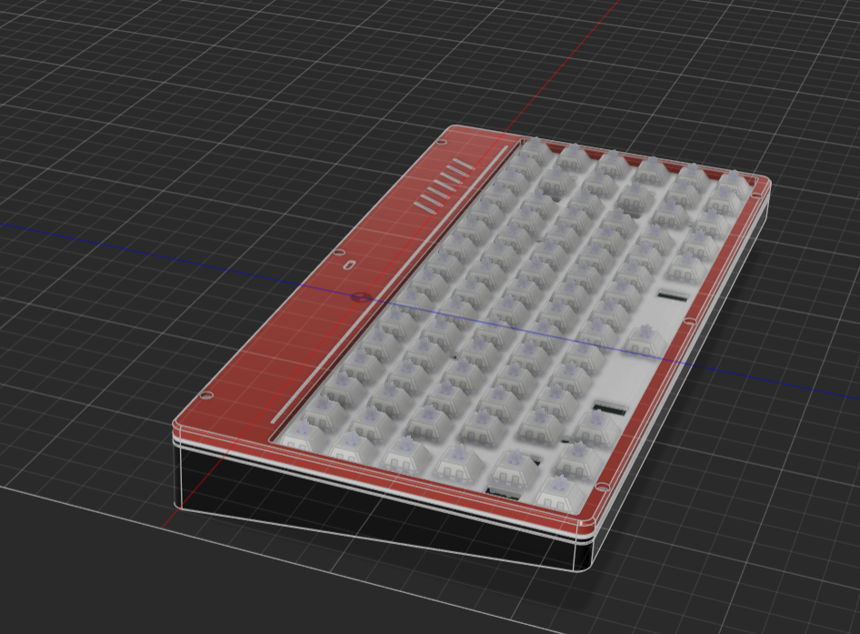 |

--- 

### journal #17 proper renders  
time spent : 2.5 hours   

  
the quick renders were fine but i wanted some really nice ones for the readme. went into the render workspace in fusion and played around with the colours and the lighting a lot. tried an orange version first, it looked kinda cool on the light background
  

  
| orange version |
| --- |
| 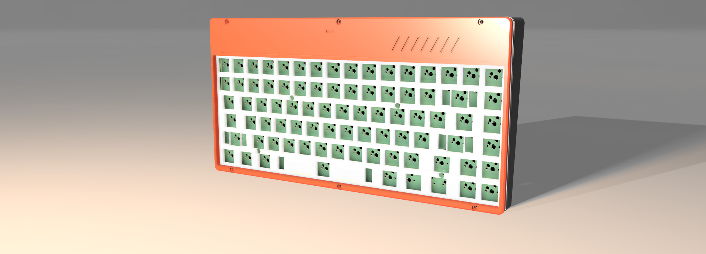 |
| 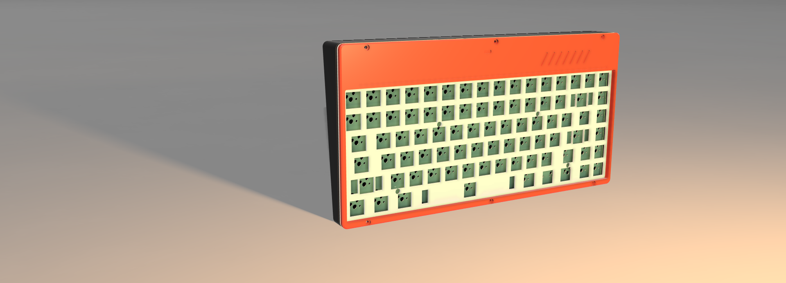 |

but i still liked the red more, so went back to red and tried it on a darker background. the dark ones look so clean, the red top frame really pops

  
| red version |
| --- |
| 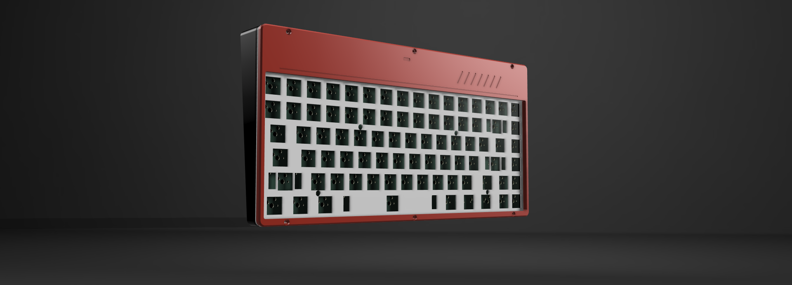 |
| 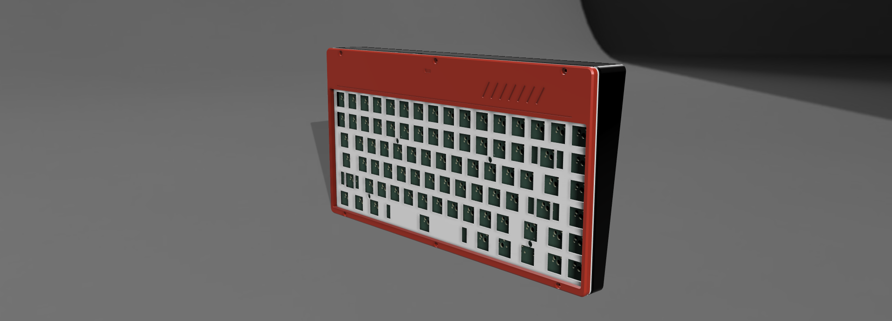 |
| 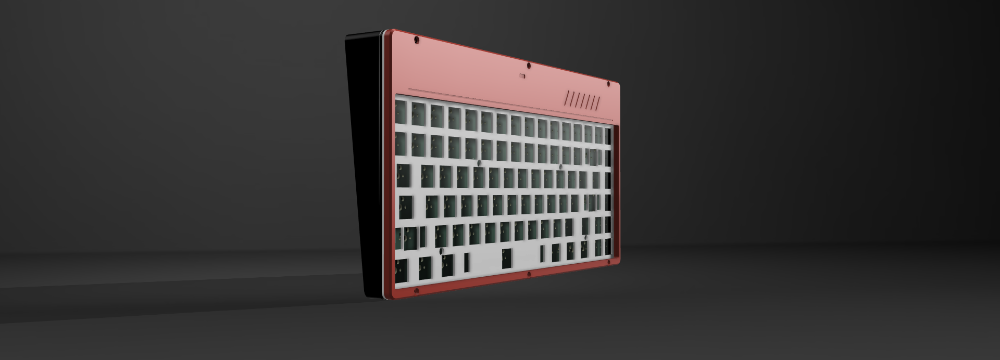 |

each render takes a while to finish so most of this time was just waiting and changing tiny stuff lol

--- 

### journal #18 making a banner  
time spent : 1.5 hours   

  
made a banner for neo like i did for rin. pink background with some blurry shapes and sparkles, the red render in the middle, big NEO KEYBOARD text on top and "75% keyboard by shadow" with my github at the bottom. took a while to get the colours to match the red of the keyboard but i love how it came out
  

  
| the banner |
| --- |
| 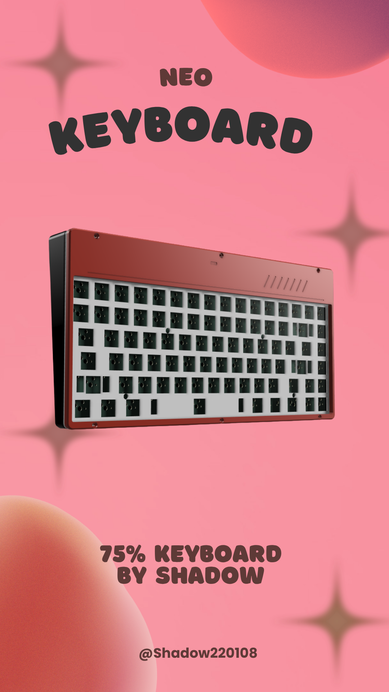 |

--- 

### journal #19 files, bom and readme  
time spent : 3 hours   

  
last part! exported all the case parts from fusion as step and stl files, the stls are the ones you would actually print. the case is about 314 x 159 mm, so it needs a big printer bed or it has to be split  
  
then i made the bom. i looked up prices for everything, the nrf52840 is only about $3.80 on lcsc which surprised me, most of the cost is the switches, keycaps, stabilizers and the battery. the 4 layer pcb is also not cheap because the board is so big. everything together comes to around $138  
  
after that i sorted everything into folders (cad, pcb, production), wrote the readme and uploaded it all to github
  

  
| final |
| --- |
| 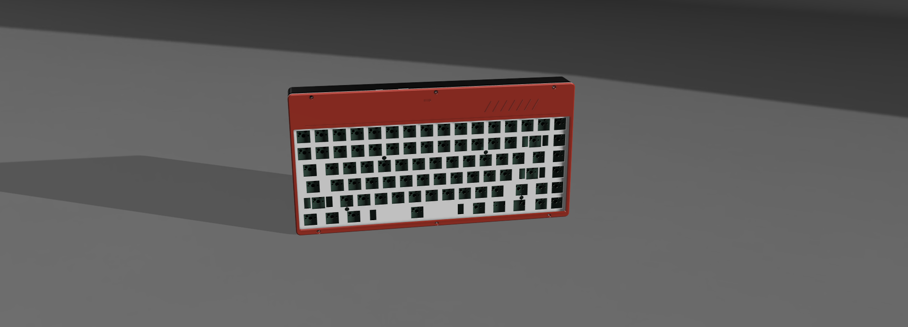 |

if you read till here, thank you :D
