<h1 align="center">
 
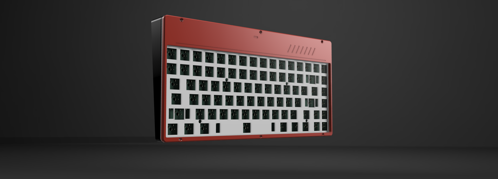
 
Neo
 
</h1>

<h3 align="center">

A wireless 75% keyboard 

</h3>

  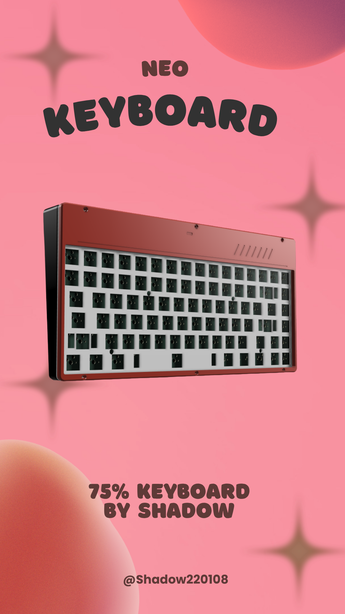

Neo is a 75% mechanical keyboard built around the Nordic nRF52840. It works over Bluetooth and over USB-C, runs on a LiPo battery that charges from the same USB-C port, and it has hotswap switches so you can change the switches without soldering anything. The PCB is a 4 layer board designed in KiCad and the case is designed in Fusion 360.

## Features

- 84 keys in a 75% ANSI layout, so you still get the F row and arrow keys
- Bluetooth 5 and USB-C from one chip (nRF52840), works with ZMK
- Kailh hotswap sockets for MX style switches
- Single cell LiPo with an MCP73831 charger, it charges while you use it
- Power switch that cuts the regulator but still lets the battery charge
- XC6220 regulator with only 8uA idle current so the battery lasts long
- Battery voltage reading so you can see the battery percentage
- 2.4GHz chip antenna with a keepout area on all 4 layers
- SWD header for flashing the bootloader
- 3 part case (bottom, plate, top frame) with a typing angle

## PCB

| Switches | MCU and antenna |
| --- | --- |
| 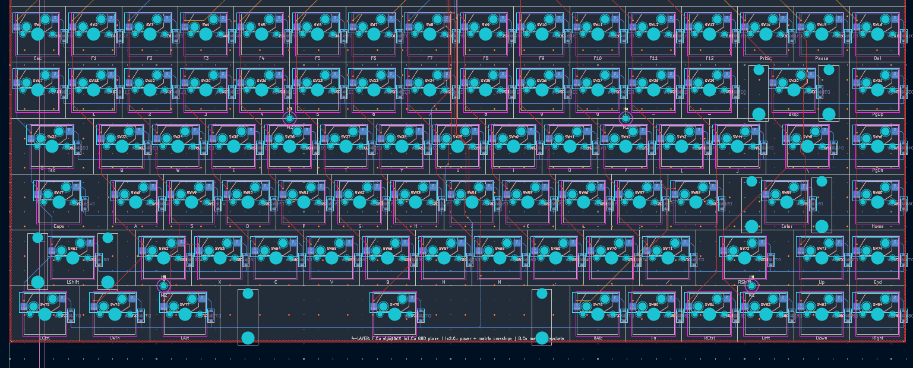 | 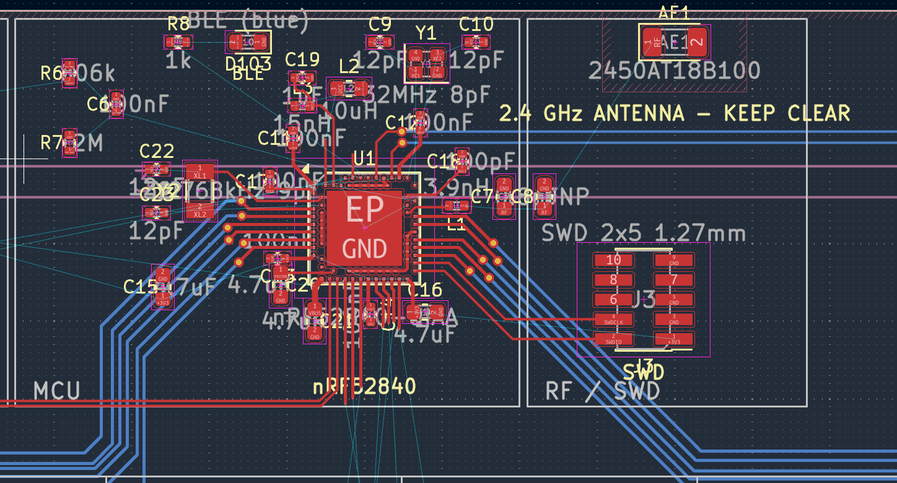 |

The board is 304.8 x 144.3 mm with 4 layers. Top and bottom have the signals and a ground fill, inner 1 is a solid ground plane and inner 2 has some power traces. The matrix is 6 rows and 16 columns with a 1N4148W diode on every key. There are 512 vias on it which is kinda crazy lol.

The USB-C has 5.1k resistors on CC1 and CC2 so C to C chargers work, a 500mA fuse and a USBLC6 ESD chip. When USB is plugged in the keyboard runs from USB and charges the battery, and when you unplug it an AO3401A switches over to the battery.

| USB-C | Charger |
| --- | --- |
| 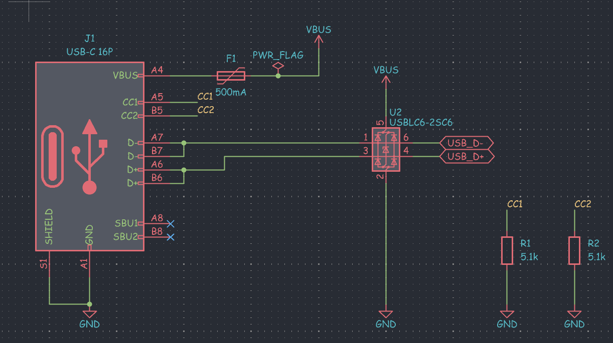 | 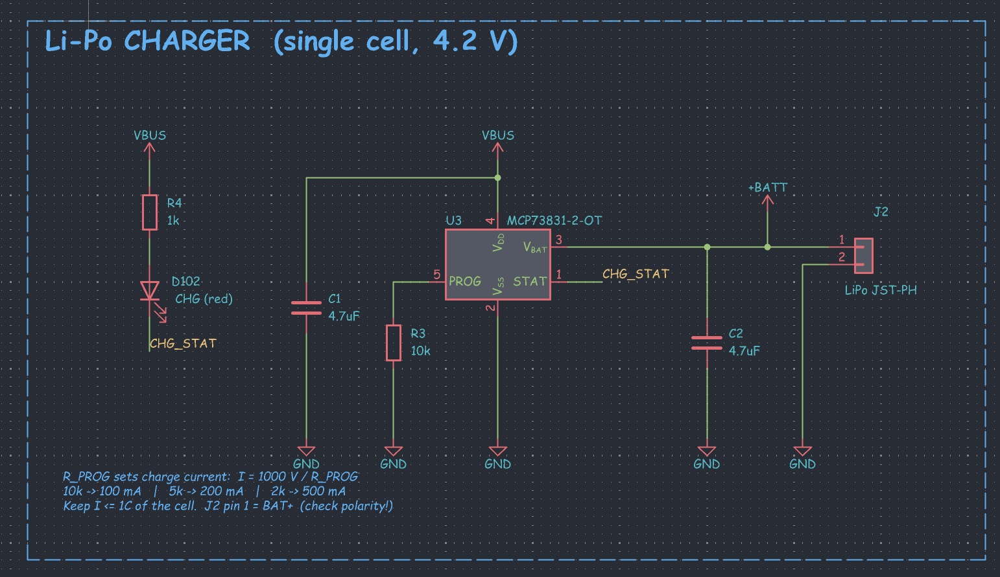 |

## Case

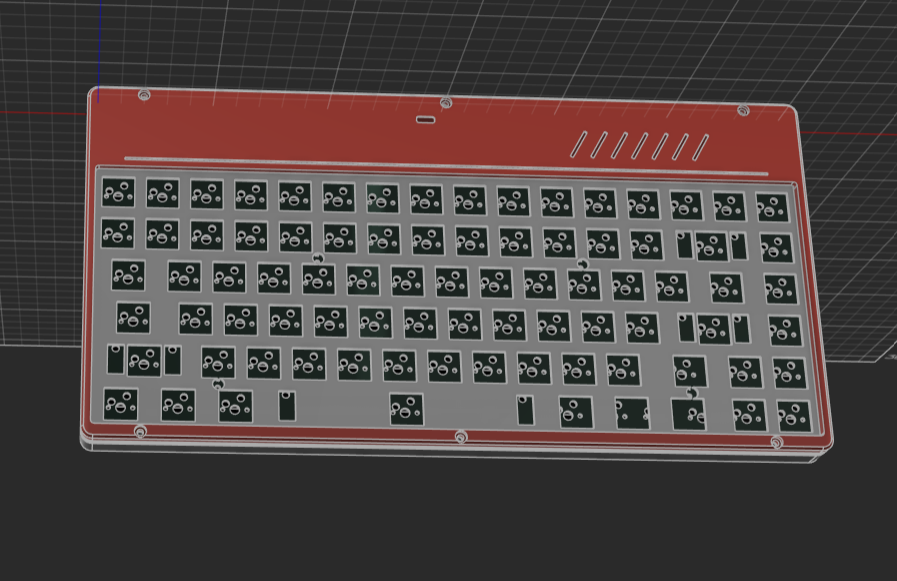

The case has 3 parts, a bottom tray with a tilt, a switch plate and a red top frame with some vent lines on it just for the looks. The PCB screws in with 6 M2 holes. Each part is about 314 x 159 mm, so you need a big printer bed for it or you have to split the parts.

| Bottom | Plate |
| --- | --- |
| 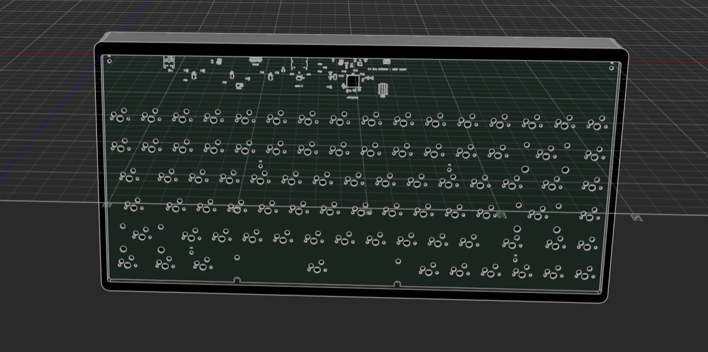 | 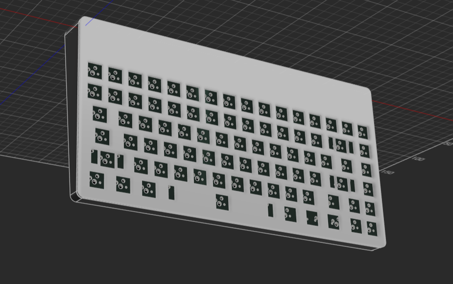 |

## Renders

| Red | Orange |
| --- | --- |
| 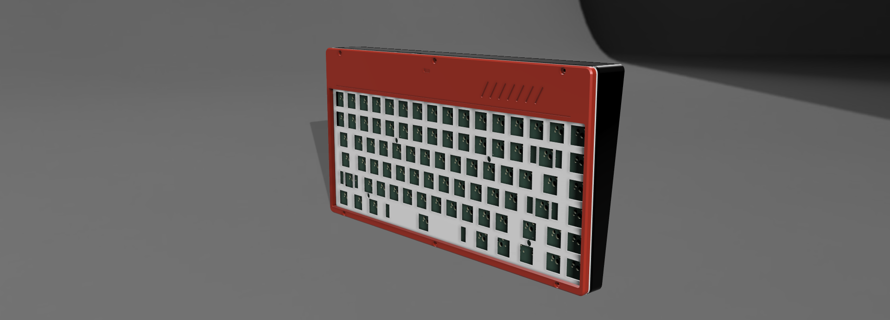 | 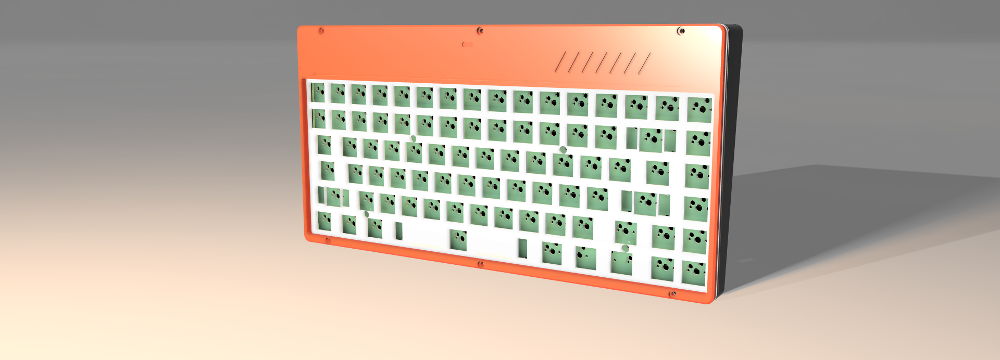 |

## BOM

|Component   |Description                                                               |Qty|Unit price ($)|Total ($)|Source       |
|------------|--------------------------------------------------------------------------|---|--------------|---------|-------------|
|PCBA        |JLCPCB 4 layer PCB, assembled                                             |1  |73.40         |73.40    |JLCPCB       |
|Switches    |Gateron G Pro 3.0, pack of 90                                             |1  |18.45         |18.45    |Kinetic Labs |
|Keycaps     |Keychron double shot PBT Cherry profile full set (218 keys, fits 75% ANSI)|1  |39.99         |39.99    |Keychron     |
|Stabilizers |Durock V3 screw-in set (4x 2u, 1x 6.25u)                                  |1  |13.99         |13.99    |Divinikey    |
|LiPo battery|3.7V 2000mAh, JST-PH                                                      |1  |12.50         |12.50    |Adafruit 2011|
|Total       |                                                                          |   |              |158.33   |             |

